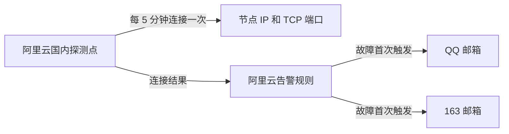

# Xboard 节点连通性邮件提醒方案

日期：2026-11-06

建议使用 **阿里云云监控 2.0 的云拨测和邮件告警**：平台从国内定时连接节点端口，出现连接异常后，分别给 QQ 邮箱和 163 邮箱发送提醒。平台全天运行，满足不依赖 Mac 在线、没有国内常开设备的条件。

第一版将告警定义为“国内探测点连接节点 TCP 端口失败”，提醒用语为“国内连接异常，疑似被封”。这能覆盖交接中出现的 TCP 建连超时场景；具体是否被 ban，仍需收到提醒后排查。

## 最小链路

探测、告警状态和邮件发送全部由平台承担。MingWorks 本次只保存方案，不增加运行服务、数据库表、发信代码或管理页面；实施工作集中在云平台配置。

阿里云文档支持按 IP 和端口建立 TCP 定时探测，并选择中国境内探测点及 5 分钟周期。[云拨测配置说明](https://help.aliyun.com/zh/cms/cloudmonitor-2-0/detection-based-on-pc-over-internet)

## 首批监控范围

建议先接入交接文档中的两条 VLESS 节点，作为本次评审的最小范围：

| 节点 | 主机 | IP | 交接记录中的端口 |
| --- | --- | --- | --- |
| 美国 1 VLESS Reality | bwgdc01 | 144.34.224.170 | TCP 35143 |
| 美国 2 VLESS Reality | bwgdc6 | 80.251.223.124 | TCP 35143 |

上述端口和连通性背景来自桌面上的《Xboard节点连通性与本机直连探测-AI交接-20261106.md》，其中实际连接结果记录于 11 月 3 日。正式配置时应读回当前节点 IP 和端口，不能直接把历史结果当成现在的状态。

现有 [服务器巡检](../../src/services/monitoring/serverHealth.ts) 通过 SSH 获取主机资源状态，与国内用户能否连接代理端口是两件事。新的告警独立观察国内到节点的路径，直接连接节点 IP，不依赖 Shadowrocket 或被监控节点转发。

## 探测和触发规则

| 项目 | 第一版设置 |
| --- | --- |
| 探测协议 | TCP 建连，目标为节点实际 IP 和服务端口；请求内容与响应内容匹配留空 |
| 探测来源 | 每个目标选 1 个中国境内运营商探测点，优先接近常用地区和宽带运营商 |
| 执行时间 | 每天全天，按北京时间显示 |
| 探测周期 | 5 分钟 |
| 建连超时 | 5 秒 |
| 告警条件 | 每个节点单独配置规则，最新一个 5 分钟统计周期可用率为 0% 时触发 |
| 首次启用 | 如果节点已经连接失败，同样触发首次告警，不要求先观察到成功 |
| 持续故障 | 同一节点、同一次故障只通知一次；平台继续定时探测 |
| 恢复后 | 成功探测使告警结束；再次连接失败时产生新告警 |
| 无探测数据 | 保留无数据状态，不当作连接成功或被封 |

这个配置优先及时提醒，单次暂时性故障也可能触发。通常在下一个探测周期发现异常，邮件还需经过平台的数据处理和投递，不承诺精确到达时间。

告警使用云监控 2.0 的通知策略，按规则和节点归并同一事件，选择“不需要重复通知”，关闭恢复邮件和通知升级；恢复状态由实际探测结果结束，不用固定时间自动清除。两条规则共用一个邮件通知策略。[通知策略说明](https://help.aliyun.com/zh/cms/cloudmonitor-2-0/cms-2-0-notification-policy)

## 邮件怎么发

创建两个联系人，分别填入 QQ 和 163 地址，加入同一个联系人组；通知策略只选择邮件渠道，接收时间设为全天。两个邮箱分别点击平台发来的激活链接后才能接收告警。邮件由阿里云发送，无需提供邮箱密码或 SMTP 授权码。[联系人和邮箱激活说明](https://help.aliyun.com/zh/cms/cloudmonitor-2-0/notification-object/)

沿用平台默认邮件模板，通过任务名和规则描述明确节点与异常。例如：

- 任务名：美国 1 VLESS 国内连通性。
- 规则名：美国 1 VLESS 国内连接异常。
- 规则描述：国内探测点无法连接节点 TCP 端口，疑似被封或服务故障，请排查。

邮件至少应能定位节点和告警时间；具体探测点、错误类型及历史结果在对应任务详情中查看。同一事件向两个邮箱各投递一份，两个节点分别故障时分别提醒。

## 费用估算

阿里云当前公布的 PC 端中国境内运营商探测单价为 **0.001 元/次**。按两个节点、每个节点一个探测点、每 5 分钟一次、30 天计算：

**2 × 1 × 12 × 24 × 30 = 17,280 次，探测费约 17.28 元/月。**

这是按上述点位类型和频率计算的估算，开通时按实际选择的点位核对价格。[探测计费说明](https://help.aliyun.com/zh/cms/cloudmonitor-1-0/product-overview/network-analysis-and-monitoring-3)

邮件通知本身不收费。[通知渠道费用说明](https://help.aliyun.com/zh/cms/cloudmonitor-2-0/notification-object/)

## 这版能发现什么

该方案用于发现所选国内线路到节点 IP 和 TCP 端口的连接异常。端口封锁、服务停止、防火墙拦截或网络故障都可能触发，因此邮件不直接判定封禁原因。

单个国内探测点只代表该条线路。如果只有用户本地运营商线路异常，其他探测点可能仍正常；选点时应尽量贴近实际使用网络。

**TCP 成功不代表 VLESS Reality 认证或代理出站成功。仅发生在协议握手阶段的异常可能漏报；Hysteria2 使用 UDP，也不在这版 TCP 监控范围内。** 如果首批必须包含 Hysteria2，需要另外确定其协议探测方式，不能用普通 UDP 发包成功代替节点可用。

## 评审后需要落实的内容

1. 确认首批是否就监控上述两条 VLESS，以及当前实际 IP 和端口。
2. 准备阿里云账号、两个收件邮箱地址，以及常用地区和运营商，完成邮箱激活。
3. 配置两条 TCP 探测任务、对应告警规则，以及共用的邮件通知策略。

完成标准是：真实连接异常产生平台告警后，QQ 和 163 两个邮箱都收到同一次事件的提醒；持续故障不重复通知；连接恢复后再次故障能够产生新提醒。以实际收件为链路完成依据。

本轮交付到方案评审，云服务开通、监控配置和邮件发送在后续实施阶段进行。
